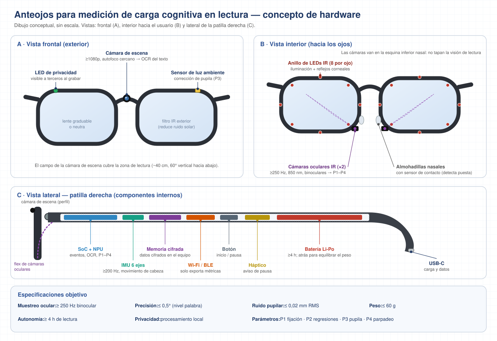
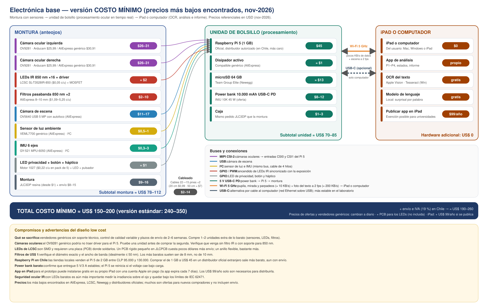

# Anteojos de carga lectora

Prototipo de investigación: anteojos de eye-tracking de bajo costo que **miden la carga
cognitiva mientras se lee un texto en pantalla** y **reestructuran el propio texto** según la
sensibilidad individual del lector (oraciones largas, voz pasiva, relativas de objeto,
nominalizaciones, léxico poco frecuente).

> No es un dispositivo médico. Antes de usarlo con personas, mida la irradiancia infrarroja
> sobre el ojo (IEC 62471) y obtenga la aprobación de un comité de ética.

## Cómo funciona

```
Anteojos (2× OV9281 IR + cámara de escena)      Raspberry Pi 5 (bolsillo)          Computador / iPad
  imagen del ojo a ~250 fps  ───────────────▶  pupila, parpadeo, marcadores  ──UDP──▶  calibración → mirada en pantalla
  marcadores ArUco de la pantalla                 (solo datos, pocos KB/s)            I-VT → fijación → palabra
                                                                                      P1–P4 → carga por oración L_s
                                                                                      perfil bayesiano del lector
                                                                                      ◀── variantes del texto (app web)
```

## Esquema del dispositivo

**Hardware de los anteojos** (vistas frontal, interior y lateral; dibujo conceptual, sin escala):



**Electrónica y costos, versión de costo mínimo** (≈ US$ 150–200):



La versión con proveedores estándar (≈ US$ 240–350) está en
[`docs/img/electronica_estandar.svg`](docs/img/electronica_estandar.svg). Detalle de
componentes y conexiones en [`docs/hardware.md`](docs/hardware.md).

## Parámetros

Cuatro parámetros oculares (ver `docs/marco_teorico.md`):

| | Parámetro | Qué indica |
|---|---|---|
| P1 | Duración de fijación residual (ajustada por largo, frecuencia y surprisal) | Costo de procesamiento léxico atribuible al lector |
| P2 | Tasa de regresiones y *go-past time* | Reanálisis sintáctico-semántico |
| P3 | Index of Pupillary Activity (IPA) | Esfuerzo global |
| P4 | Tasa de parpadeo + pendiente duración~frecuencia | Desacoplamiento atencional (*mind wandering*) |

**Un texto, tres tramos.** El texto (≤100 páginas, Arial 12, interlineado 1,5, márgenes normales,
mostrado al 150 %) se lee en 4–6 sesiones:

1. **A — Línea base** (págs. 1–8): texto original; se aprenden las medias del lector.
2. **B — Exploración** (págs. 9–30): cada oración candidata aparece al azar en versión original o
   modificada → efecto causal de cada rasgo en este lector.
3. **C — Adaptación** (págs. 31+): se muestra la versión con menor carga predicha; ~18 % de
   oraciones quedan sin modificar como control.

Las variantes de cada oración se escriben y **revisan antes** de la primera lectura; durante la
sesión solo se elige cuál mostrar, y **nunca se modifica la página que se está leyendo**.

## Estructura

```
config/config.json        parámetros (pantalla, umbrales, tramos, priors)
pi/                       código del Raspberry Pi: cámaras, pupila, sensores, envío UDP
host/                     análisis en el computador
  session.py              orquesta todo el flujo
  events.py               I-VT: fijaciones, sacadas, parpadeos
  calibration.py          pupila → escena (polinomio) ; geometry.py: escena → pantalla (homografía)
  words.py                fijación → palabra, con corrección de deriva vertical
  metrics.py              P1–P4 e índice de carga por oración
  profile.py              perfil bayesiano del lector
  adapter.py              política de variantes (tramos A/B/C)
  server.py, web/         servidor FastAPI + app de lectura en el navegador
sim/simulate_reader.py    lector simulado: prueba todo sin hardware
tools/                    generar marcadores ArUco; anotar un texto con spaCy
data/texto_ejemplo.json   formato del texto con variantes
docs/                     marco teórico y hardware
tests/                    pytest
```

## Puesta en marcha

### 1. Sin hardware (simulador)

```bash
python -m venv .venv && source .venv/bin/activate
pip install -r requirements-host.txt -r requirements-dev.txt
pytest -q
python -m sim.simulate_reader --paginas 40
```

El simulador genera un lector con sensibilidades conocidas y muestra el perfil aprendido.

### 2. Computador

```bash
pip install -r requirements-host.txt
pip install opencv-python && python tools/generar_marcadores.py   # una vez
python -m host.server --texto data/texto_ejemplo.json
```

Abra `http://localhost:8000` en pantalla completa y pulse **Calibrar**. Ajuste
`pantalla.distancia_mm` y `pantalla.px_por_mm` en `config/config.json` para su monitor.
Las sesiones se guardan en `data/sesiones/` (JSONL) y el perfil final en `perfil-*.json`.

### 3. Raspberry Pi 5

```bash
sudo apt install -y python3-picamera2 python3-opencv python3-gpiozero
sudo raspi-config   # activar I2C
pip install -r requirements-pi.txt
rpicam-hello --list-cameras    # confirmar que aparecen las dos OV9281
python -m pi.main --host <IP del computador>
```

## Estado

| Componente | Estado |
|---|---|
| Núcleo de análisis (I-VT, P1–P4, perfil, política) | Probado con tests y simulador |
| Servidor y app web | Probado con TestClient; falta prueba con usuarios |
| Código del Pi (cámaras, pupila, sensores) | **Sin probar en hardware**: verificar modos de cámara y umbrales |
| Corrección del diámetro pupilar por posición de mirada (Hayes & Petrov, 2016) | Pendiente |
| Surprisal con modelo de lenguaje en español | Pendiente (el formato admite `surprisal` por palabra) |

## Licencia

MIT. Ver `LICENSE`.
